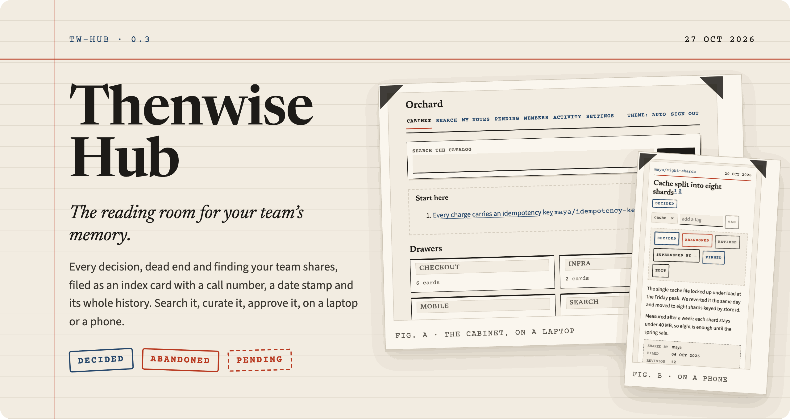
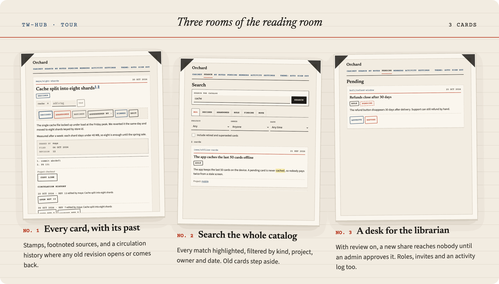
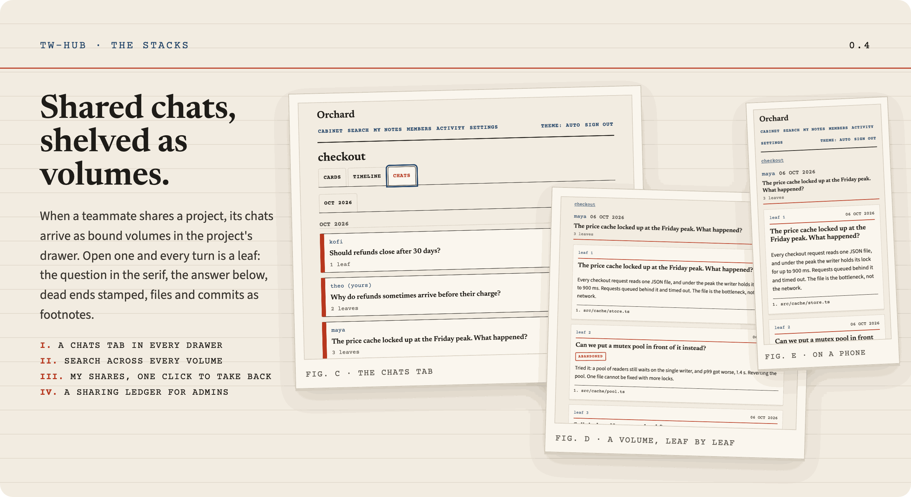
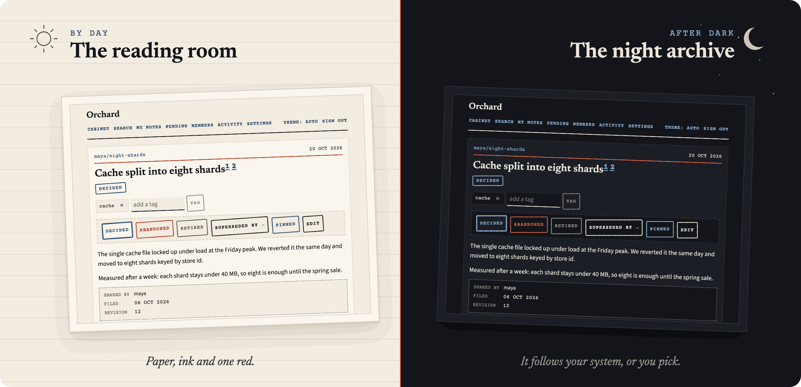
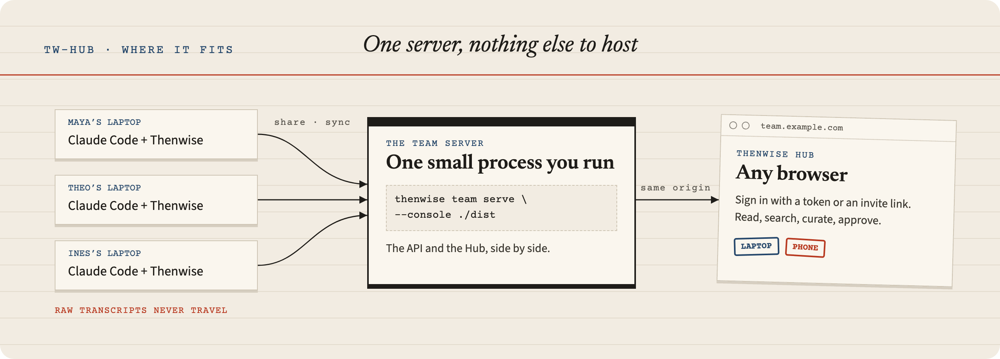

<p align="center"></p>

<p align="center">
  
  
  
  
</p>

<h3 align="center">Your team's decisions, dead ends, findings and shared chats, filed like a library.<br>Open it in any browser. Nothing else to host.</h3>

<br>

[Thenwise](https://github.com/dheerajponnaganti/thenwise) gives Claude Code a memory, and Thenwise Teams lets a team share the parts that matter. The Hub is where people read it.

Every shared note becomes an index card with a call number, a date stamp and its full circulation history. Every shared chat becomes a bound volume you read leaf by leaf. Each project is a drawer. Search runs across the whole cabinet. Admins sit at the librarian's desk, approve new cards, and keep the shelves tidy.

## A walk through the reading room

<p align="center"></p>

- **The cabinet.** Every project is a drawer, pinned cards wait under Start here, and the newest cards sit on top.
- **Cards with a past.** Stamp a card decided, abandoned, retired or superseded. Footnoted sources point back to the commit or the chat. Any old revision opens in place, and an editor can bring it back.
- **Search the whole catalog.** Full text across every card, with each match highlighted and filters for kind, project, owner and date. Superseded cards step aside until you ask for them.
- **A drawer per project.** Each one has its cards, a timeline, and the chats teammates shared.
- **Shared chats, shelved as volumes.** Open one and read every turn as a leaf, dead ends stamped in their own words. Search reaches into every volume.
- **Your shares, in your hands.** My shares lists what you share. Pause a project, take a volume back, or unshare it all in one stamp.
- **No silent overwrites.** When two people edit the same card, the Hub shows both versions and lets you keep theirs or take yours.
- **The librarian's desk.** Turn on the review queue and a new share reaches nobody until an admin approves it. Invite people with a link, set roles, rotate a token, read the activity log, keep a sharing ledger of every shared project, set how long chats are kept, and export everything as a zip.

## Volumes and leaves

<p align="center"></p>

A shared chat is a bound volume on its project's shelf. Open the project drawer and read the Chats tab: the owner's slip, the date and the first prompt on the spine. Open a volume and it turns into leaves, one card per turn, with dead ends stamped ABANDONED and the files and commits it touched as footnotes. Everyone can read a volume. Nobody can edit one.

## By day and after dark

<p align="center"></p>

The reading room by day, the night archive after dark. The Hub follows your system, or you choose. Every screen works on a phone, from a card to the review queue.

## Where it fits

<p align="center"></p>

The Hub is a static site. The Thenwise team server serves it beside the API on the same origin, so there is one process to run and nothing else to host. Chats stay home unless you share a project. Raw transcripts never travel. The Hub shows the notes people chose to share and the chats of the projects they share.

## Run it

Build the Hub, then let the team server serve it:

```sh
npm ci
npm run build
thenwise team serve --dir ./team-data --console ./dist
thenwise team invite alice --dir ./team-data   # prints a token for the first member, the owner
```

Open `http://127.0.0.1:<port>` and paste the token, or open an invite link. Admins make invite links on the Members screen.

Any static host works too, as long as the server lists its origin with `--allow-origin`. For a server on the internet, the [Docker kit in thenwise](https://github.com/dheerajponnaganti/thenwise/tree/main/docker) runs the server, the Hub and Caddy with automatic certificates.

## Develop

```sh
npm run dev          # Vite on :5173, proxies /v1 to a server on :4170
npm test             # unit tests (Vitest)
npm run e2e          # builds, starts a real thenwise server, runs Playwright
npm run gen:types    # regenerates src/api/types.ts from api/openapi.json
```

`api/openapi.json` is a copy of the spec from thenwise (Teams API 1.1). `npm run build` fails when `src/api/types.ts` no longer matches it.

The end-to-end tests need a thenwise checkout. Set `THENWISE_SRC` to its folder (the default is `~/memory-v2`). Install the browser once with `npx playwright install chromium`.

`/catalog` shows every component in both themes.

## Compatibility

Thenwise Hub 0.x needs `thenwise >= 0.1.12` (Teams API v1). The chat screens need `thenwise >= 0.1.17` (Teams API 1.1) and stay away on an older server. The Hub has its own version numbers.

## Licence

MIT. The fonts (Newsreader, Source Sans 3, Courier Prime) are under the SIL Open Font Licence. The licence files are in `src/fonts/`.

---

<p align="center"><b>Thenwise Hub</b>: the reading room for your team's memory.</p>
